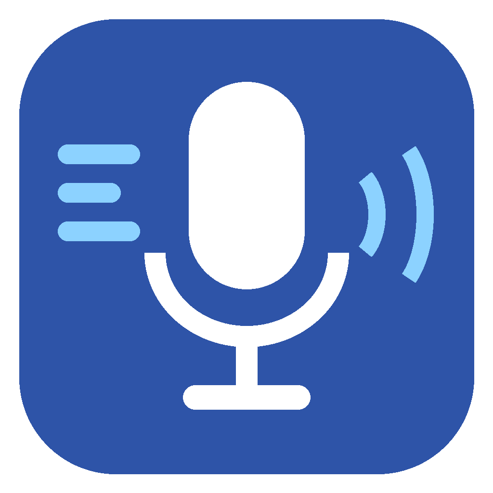
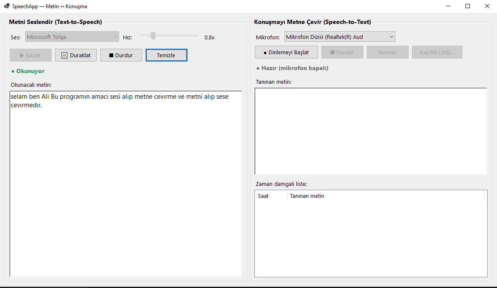
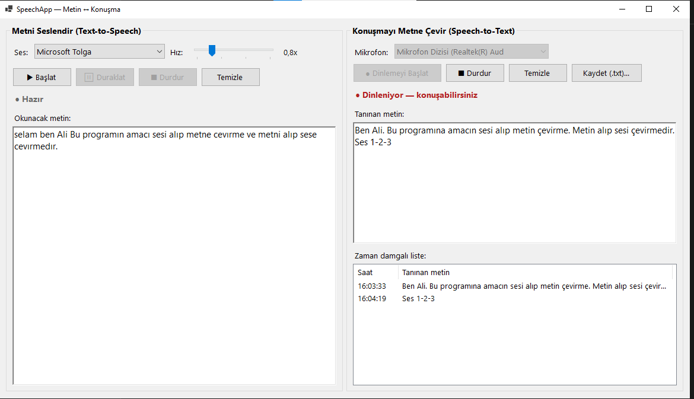

# SpeechApp (Speech-to-Text / Text-to-Speech)

[](https://github.com/Ali-Istanbullu/YMH219-SpeechApp/actions/workflows/ci.yml)

<p align="center"></p>

Metin ile konuşma arasında iki yönlü dönüşüm yapan Windows Forms uygulaması. Solda yazılan metin Türkçe sesle
okunur. Sağda mikrofondan konuşulanlar **internetsiz** olarak metne çevrilir: her cümleden sonraki kısa
sessizlikte o cümle yazıya dökülür. **YMH219 Nesne Tabanlı Programlama**, 4. uygulama ödevi.

**Ali İstanbullu, 250542019**

## Ekran Görüntüleri

| Metni seslendirme | Konuşmayı metne çevirme |
|---|---|
|  |  |

## Özellikler

**Metni Seslendir (Text-to-Speech)**
- Kutudaki metin Windows'un Türkçe sesiyle (Microsoft Tolga) okunur.
- Başlat, Duraklat/Devam, Durdur, Temizle.
- Ses seçimi ve hız ayarı (0,5x–2x).

**Konuşmayı Metne Çevir (Speech-to-Text)**
- Mikrofon seçimi, Dinlemeyi Başlat, Durdur, Temizle.
- Konuşma sessizliklerden parçalara bölünür, her parça sırayla metne çevrilir. Durdur'a basılınca elde kalan kısım da çevrilir.
- Tanınan metin hem metin alanında hem **saatli listede** görünür.
- **Kaydet (.txt):** her satır `[14:03:20] metin` biçiminde, UTF-8.

**Her iki bölüm**
- Renkli durum yazısı: Hazır / Ses hazırlanıyor / Okunuyor / Duraklatıldı / Model yükleniyor / Dinleniyor · metne çevriliyor.
- Anlaşılır Türkçe hata mesajları. Her mesaj ne yapılacağını da söyler:
  - mikrofon yok ya da Windows mikrofon izni kapalı
  - mikrofon çıkarıldı
  - Türkçe ses yüklü değil (nereden ekleneceği yazılır)
  - model dosyası yok ya da bozuk
  - Visual C++ eksik
  - hoparlör yok

## Kurulum

[Releases](https://github.com/Ali-Istanbullu/YMH219-SpeechApp/releases) sayfasından `SpeechApp-Kurulum-1.0.0.exe`
(7,1 MB) indirilip çalıştırılır. Kurulum sırasında eksik olanlar indirilip sessizce kurulur. Bir şey inmez ya da
kurulamazsa kurulum hata verip durur.

| Gereksinim | Kurulum ne yapıyor |
|---|---|
| Windows 10/11 x64 | Windows 10 altı ve Arm64 Windows'ta kurulum başlamaz |
| .NET 10 Desktop Runtime (x64) | Yoksa indirip kurar |
| Visual C++ 2015-2022 (x64) | Yoksa indirip kurar (whisper.cpp DLL'leri ister) |
| Konuşma tanıma modeli `ggml-small-q8_0.bin` (252 MB) | Her zaman indirir, SHA-256 ile doğrular |
| Türkçe ses (Microsoft Tolga) | Kurulum ekleyemez. Yoksa: Ayarlar → Saat ve dil → Konuşma → Ses ekle |
| Mikrofon izni | Ayarlar → Gizlilik ve güvenlik → Mikrofon → "Masaüstü uygulamalarının erişmesine izin ver" |

Kurulum sırasında internet gerekir, sonrası tamamen internetsiz çalışır. Kaldırınca program klasörü ve model silinir;
`%LocalAppData%\SpeechApp` (loglar) kalır.

### Kaynak koddan

Windows x64, .NET SDK 10.0.401. Model bir kez repo kökündeki `model\` klasörüne indirilir. Bu klasör `.gitignore`'da;
derlemede çıktı klasörüne kopyalanır.

```powershell
mkdir model -Force | Out-Null
curl.exe -L -o model\ggml-small-q8_0.bin https://huggingface.co/ggerganov/whisper.cpp/resolve/main/ggml-small-q8_0.bin
(Get-FileHash model\ggml-small-q8_0.bin).Hash   # 49C8FB02B65E6049D5FA6C04F81F53B867B5EC9540406812C643F177317F779F
dotnet build -c Release
dotnet run --project src/SpeechApp.WinForms -c Release
```

Kurulum dosyası için: `installer\kurulum-olustur.ps1` (Inno Setup gerekir).

## Testler

| Proje | Ne test ediliyor | Sayı |
|---|---|---|
| `SpeechApp.UnitTests` | Sessizlik ayırıcı, tanıma ve seslendirme yöneticileri (sahte mikrofon/tanıyıcı/hoparlörle), .txt biçimi | 23 |
| `SpeechApp.SmokeTests` | DI kayıtları, exe açılıp kapanıyor mu, model yok/bozuk hatası, **uçtan uca**: Tolga'nın okuduğu cümle Whisper ile geri metne | 5 |
| `SpeechApp.PerformanceTests` | Sessizlik ayırıcının hızı, Whisper'ın bir cümleyi çevirme süresi | 2 |

Model ya da Türkçe ses gerektiren testler, bunlar yoksa atlanır (GitHub'ın sunucusunda ikisi de yok).

Ölçümler (geliştirici bilgisayarı: AMD Athlon Silver 7120U, 2 çekirdek, Release):

| Ölçüm | Sonuç | Eşik |
|---|---|---|
| Model yükleme | 1,2 sn | — |
| Çevirme süresi / ses süresi (small-q8_0) | 3,79 ve 3,9 kat (4,2 sn ses → 16,2 sn) | 6 kat |
| Sessizlik ayırıcı, 10 dakikalık ses | 80 ms | 1000 ms |
| Tolga'nın okuduğu iki cümle | Whisper ikisini de hatasız çevirdi | — |

## Teknolojiler

C# / .NET 10, Windows Forms, Windows.Media.SpeechSynthesis (WinRT, Windows 10 SDK). NuGet paketleri:
- Whisper.net 1.9.1, Whisper.net.Runtime ve Whisper.net.Runtime.NoAvx 1.9.1: whisper.cpp; NoAvx, AVX desteklemeyen işlemciler için
- NAudio.WinMM 3.3.0: mikrofon ve hoparlör
- Microsoft.Extensions.DependencyInjection 11.0.0
- Serilog 4.4.0 ve Serilog.Sinks.File 7.0.0
- MSTest 4.0.2

Kurulum Inno Setup ile, CI/CD GitHub Actions ile.

## Proje Yapısı

```
src/SpeechApp.Core            Mantık (paketsiz): seslendirme/tanıma yöneticileri, sessizlik ayırıcı, arayüzler, hata türleri
src/SpeechApp.Infrastructure  Gerçek uygulamalar: Windows seslendirme, NAudio mikrofon/hoparlör, Whisper, Serilog
src/SpeechApp.WinForms        SpeechApp.exe: pencere, genel hata yakalayıcı, DI (sadece Program.cs)
tests/...                     Birim, smoke, performans testleri
installer/                    Inno Setup betiği ve kurulum oluşturma betiği
.github/workflows             CI (her push'ta derle + test), Release (v* etiketiyle kurulum dosyası)
```

## Kod Sözlüğü

| Kod | Anlamı |
|---|---|
| `SeslendirmeYoneticisi` | Metni okuma: Başlat, Duraklat/Devam, Durdur ve durum (Hazır/Hazırlanıyor/Okunuyor/Duraklatıldı) |
| `TanimaYoneticisi` | Dinleme: modeli hazırla, mikrofonu aç, parçaları sırayla çevirt, sonuçları listele |
| `SessizlikAyirici` | Mikrofon sesini 20 ms'lik çerçevelerde ses şiddetine bakarak cümlelere böler (0,7 sn sessizlik = cümle sonu) |
| `TanimaSonucu`, `TanimaDokumu` | Saatli bir tanıma satırı; .txt biçimi |
| `ISeslendirici` / `WindowsSeslendirici` | Metin → WAV (Windows'un Türkçe sesi) |
| `ISesCalar` / `NAudioSesCalar` | WAV'ı hoparlörden çalar, duraklatır |
| `IMikrofon` / `NAudioMikrofon` | 16 kHz tek kanal mikrofon kaydı |
| `IKonusmaTanici` / `WhisperTanici` | Ses parçası → Türkçe metin (Whisper, internetsiz) |
| `MikrofonHatasi`, `SeslendirmeHatasi`, `TanimaHatasi` | Beklenen hatalar; mesajları kullanıcıya aynen gösterilir |
| `GenelHataYakalayici` | Beklenmeyen hatalar (bug): Debug'da debugger durur, Release'te log + tek mesaj |

## Sınırlamalar

- **Hız işlemciye bağlı.** Konuşma tanıma işlemcide çalışır. 2 çekirdekli geliştirici bilgisayarında bir cümlenin
  çevrilmesi, cümlenin süresinin yaklaşık 4 katı sürdü. Güçlü işlemcilerde daha hızlıdır. Ekran kartı kullanılmıyor.
- **Doğruluk mikrofona ve cümle uzunluğuna bağlı.** Temiz seste (Tolga) hata görülmedi. Bilgisayar mikrofonuyla
  söylenen kısa, tek kelimelik parçalarda ek hataları görüldü (örnek: "metne" → "metin").
- Sadece Türkçe. Seslendirme için Windows'ta Türkçe ses yüklü olmalı.
- Sadece Windows 10/11 x64. Kurulum sırasında internet gerekir (model 252 MB).
- Kurulum dosyası imzasız. SmartScreen uyarısında "Ek bilgi → Yine de çalıştır".
- Konuşulan ve okunan metinler loga yazılmaz. Loglar `%LocalAppData%\SpeechApp\logs` altında, 1 MB × 5 dosya.

## Lisans

[MIT](LICENSE) © 2026 Ali İstanbullu. Whisper modeli (OpenAI Whisper, whisper.cpp ggml biçimi) MIT lisanslıdır ve
kurulum sırasında Hugging Face'ten (`ggerganov/whisper.cpp`) indirilir; repoda ve kurulum dosyasında yer almaz.
